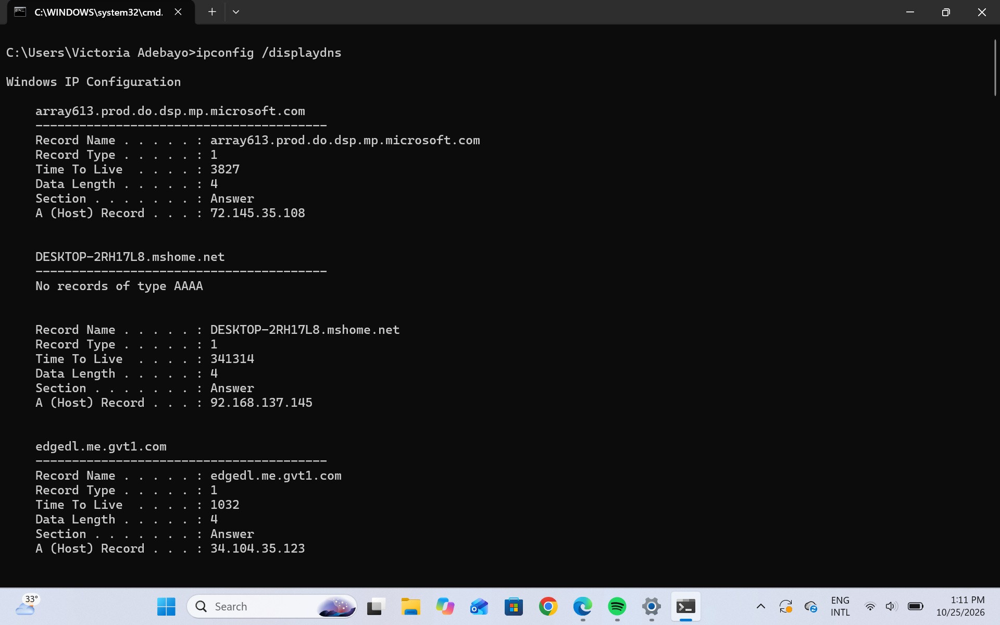
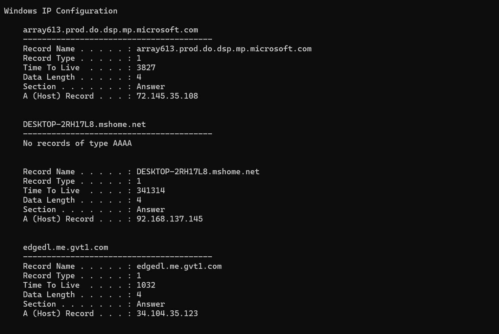
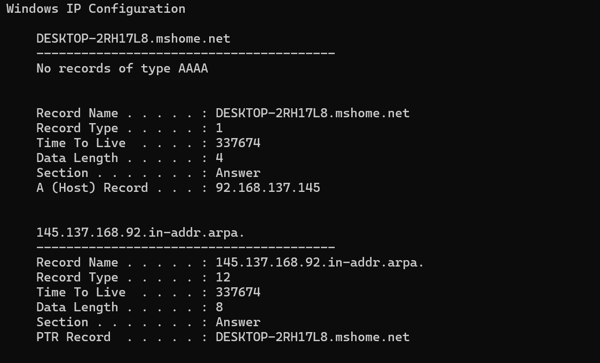
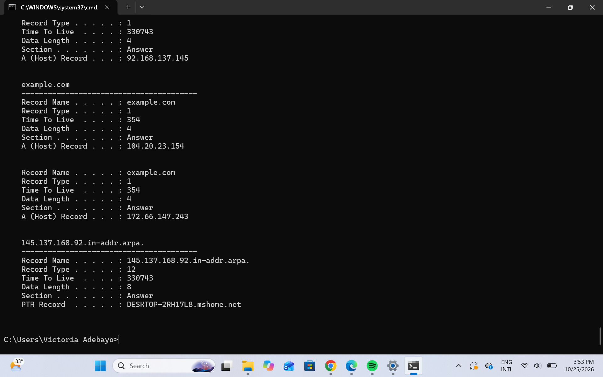

# DNS Cache Inspection and TTL Analysis

## 1. Project Overview

This project demonstrates how DNS caching works on a Windows system, including inspecting cached DNS records, observing Time to Live (TTL) changes, clearing the DNS resolver cache, and verifying how new DNS records are stored.

The lab was performed using Windows Command Prompt and built-in networking commands.

## 2. Objectives

- Inspect DNS records stored in the Windows DNS resolver cache.
- Identify different DNS record types.
- Observe how cached DNS TTL values decrease over time.
- Clear the DNS resolver cache.
- Verify DNS resolution and cache repopulation.
- Understand the security relevance of DNS caching.

## 3. Tools Used

- Windows Command Prompt
- Windows DNS Client
- `ipconfig`
- `ping`

## 4. DNS Cache Inspection

The first step was to inspect the existing DNS resolver cache using:

```cmd
ipconfig /displaydns
```

The command displayed previously cached DNS records, including A, CNAME, and PTR records.

### Observations

Some records identified during the inspection included:

| Domain | Record Type | TTL (Seconds) |
|---|---|---:|
| array613.prod.do.dsp.mp.microsoft.com | A | 3827 |
| edgedl.me.gvt1.com | A | 1032 |
| ecs.office.com | CNAME | 1 |
| login.live.com | CNAME | 44 |
| DESKTOP-2RH17L8.mshome.net | A | 341314 |

The results showed that Windows maintained DNS records with different remaining TTL values.

### Screenshot — Initial DNS Cache



## 5. DNS TTL Observation

To observe TTL changes, the following command was executed again after some time:

```cmd
ipconfig /displaydns
```

The cached A and PTR records associated with the local hostname were compared.

| Record Type | Initial TTL | Subsequent TTL |
|---|---:|---:|
| A | 341314 | 337674 |
| PTR | 341314 | 337674 |

The TTL decreased by 3,640 seconds, approximately one hour and 40 seconds.

### Findings

- Cached DNS records have a remaining lifetime.
- The remaining TTL decreases as time passes.
- Records may expire and disappear from the cache.
- Different DNS records can have different TTL values.

### Screenshot — DNS TTL Decrease



## 6. DNS Cache Clearing

The Windows DNS resolver cache was cleared using:

```cmd
ipconfig /flushdns
```

The command returned:

```text
Windows IP Configuration

Successfully flushed the DNS Resolver Cache.
```

The cache was subsequently inspected using:

```cmd
ipconfig /displaydns
```

The local hostname's A and PTR records were still visible in a later inspection.

Their TTL values had decreased further, but the available output did not establish whether they had persisted continuously or had been restored after the flush.

### Screenshot — DNS Cache After Flush



## 7. DNS Cache Repopulation

To test whether new DNS records could be cached, the following command was executed:

```cmd
ping -4 -n 1 example.com
```

### Ping Result

```text
Pinging example.com [104.20.23.154] with 32 bytes of data:
Reply from 104.20.23.154: bytes=32 time=194ms TTL=48

Ping statistics for 104.20.23.154:
Packets: Sent = 1, Received = 1, Lost = 0 (0% loss)
```

The domain successfully resolved to an IPv4 address, and the ICMP request received a response.

The DNS cache was then inspected again:

```cmd
ipconfig /displaydns
```

### Cached DNS Records

| Domain | Record Type | IP Address | Remaining DNS TTL |
|---|---|---|---:|
| example.com | A | 104.20.23.154 | 354 seconds |
| example.com | A | 172.66.147.243 | 354 seconds |

The results confirmed that Windows had cached two IPv4 addresses for `example.com`.

The 354-second DNS TTL represented the remaining cache lifetime when inspected.

The TTL value of 48 in the ping response referred to the IP packet's remaining hop limit, not the DNS record's cache lifetime.

### Screenshot — DNS Cache Repopulation



## 8. Additional Network Observation

During the investigation, the `ipconfig` command was used to inspect the computer's network configuration.

The following IPv4 addresses were identified:

| Adapter | IPv4 Address | Default Gateway |
|---|---|---|
| Ethernet | 192.168.56.1 | Not configured |
| Wi-Fi | 172.20.10.3 | 172.20.10.1 |

A previously cached hostname record pointed to `92.168.137.145`, which did not match either interface address shown during the inspection.

The discrepancy requires further verification. The available evidence does not establish that it was caused by malicious activity.

## 9. Cybersecurity Relevance

DNS caching is important in cybersecurity investigations because endpoints may reuse cached DNS information without generating a new DNS query for every connection.

For SOC Analysts, DNS cache inspection can help identify previously resolved domains and support investigations involving suspicious network connections.

DNS cache information can also be useful when investigating:

- DNS cache poisoning.
- Suspicious domain resolution.
- Malicious traffic redirection.
- Connections to known malicious IP addresses.
- Unexpected changes in DNS responses.

However, cached DNS records alone do not prove that a website was visited or that malicious activity occurred.

They should be correlated with DNS server logs, firewall logs, endpoint telemetry, and other available evidence.

## 10. Conclusion

This project demonstrated how DNS caching works on a Windows system.

The initial inspection identified different DNS record types and TTL values. Subsequent inspections showed that cached records' remaining TTL values decreased over time.

The Windows DNS resolver cache was successfully flushed, and a later DNS resolution test confirmed that new A records for `example.com` were present in the cache.

The lab provided practical experience with Windows DNS troubleshooting and demonstrated the relevance of DNS caching to network monitoring and security investigations.
